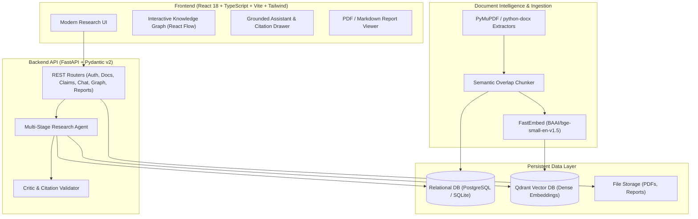
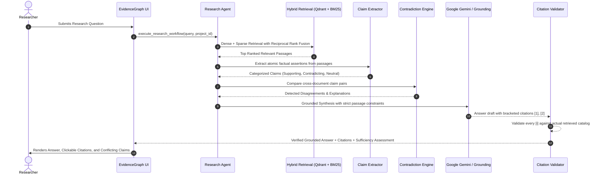
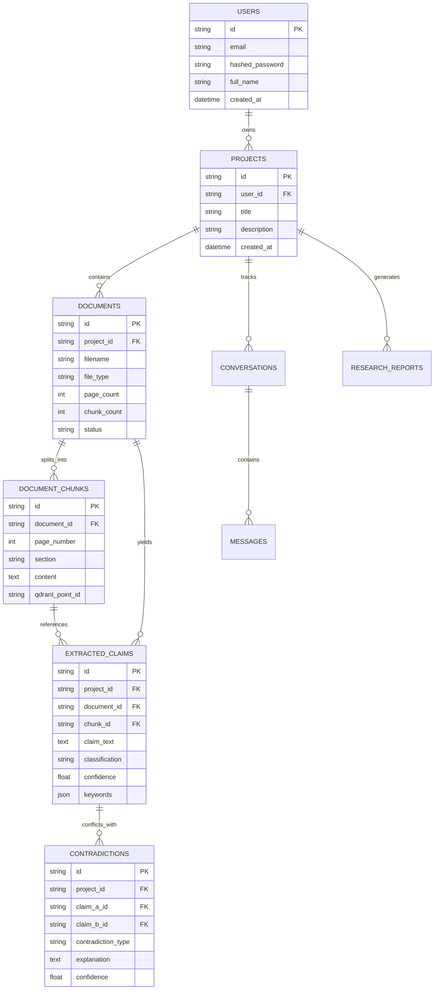

# EvidenceGraph AI
### An Evidence-Grounded AI Research and Knowledge Intelligence Platform

[](https://python.org)
[](https://fastapi.tiangolo.com)
[](https://react.dev)
[](https://www.typescriptlang.org)
[](https://tailwindcss.com)
[](https://qdrant.tech)
[](https://opensource.org/licenses/MIT)

---

## 1. Project Overview & Vision

Conventional Large Language Model applications often generate fluent, persuasive answers without verifiable backing. In scientific, legal, and biomedical research, ungrounded assertions lead to dangerous hallucinations and unvalidated claims.

**EvidenceGraph AI** enforces a fundamental principle:

> **Every important factual claim must be traceable to its supporting evidence.**

EvidenceGraph AI is a full-stack research intelligence platform where users upload multi-document corpuses (PDFs, DOCX, TXT, Markdown), extract discrete factual claims, detect cross-document contradictions, generate grounded answers with numbered source citations, and visualize conceptual relationships through an interactive knowledge graph.

---

## 2. Core Architecture



---

## 3. Controlled AI Agent Workflow



---

## 4. Database Schema Design



---

## 5. Key Modules Implemented

### Module A: Authentication and Workspace
- User registration and login with bcrypt hashing and signed JWT authentication.
- Workspace-level data isolation: documents, vectors, claims, and chat sessions are strictly private to the user.

### Module B: Document Intelligence Pipeline
- Handles PDF (PyMuPDF with page geometry and text normalization), DOCX (python-docx), TXT, and Markdown.
- Semantic overlapping chunker preserving page numbers, section headers, and token counts.
- Background asynchronous processing for large document libraries.

### Module C: Advanced Retrieval Engine
- Hybrid retrieval: Qdrant dense vector search (Cosine distance) + BM25 keyword matching (`rank-bm25`).
- Reciprocal Rank Fusion (RRF): $RRF(d) = \sum \frac{1}{60 + rank_i(d)}$.
- Jaccard token deduplication removing redundant passages.

### Module D: Evidence & Claim Extraction Engine
- Isolates atomic, verifiable statements from retrieved passages.
- Classifies claims into `SUPPORTING`, `CONTRADICTING`, `NEUTRAL`, and `INSUFFICIENT`.
- Tagging of key scientific concepts for graph indexing.

### Module E: Grounded Answer Generation & Citation Validation
- Strict grounding with Google Gemini 2.5 Flash and deterministic synthesis fallback.
- Explicit insufficient evidence communication: *"The available documents do not provide sufficient evidence to answer this question reliably."*
- Verification layer: rejects any citation number not present in the indexed source catalog.

### Module F: Contradiction Detection Engine
- Cross-document comparative analysis identifying direct contradictions, context-dependent variances, and experimental differences.
- Side-by-side claim comparison with detailed explanations and original passages.

### Module G: Interactive Knowledge Graph
- React Flow interactive canvas displaying Documents, Claims, and Concepts.
- Edges: `EXTRACTED_FROM`, `SUPPORTS`, `CONTRADICTS`, `RELATED_TO`.
- Full zoom, pan, node search, relationship filtering, and slide-out evidence inspection drawer.

### Module H & I: Research Reports & Export
- Formatted investigation reports containing executive summaries, key findings, supporting citations, and limitation audits.
- Export options: publication-quality PDF via ReportLab and raw scientific Markdown.

---

## 6. API Reference

| Method | Endpoint | Description |
|---|---|---|
| `POST` | `/api/auth/register` | Register new researcher account |
| `POST` | `/api/auth/login-json` | Authenticate and obtain JWT access token |
| `GET` | `/api/auth/me` | Fetch authenticated researcher profile |
| `GET` | `/api/projects/` | List user's isolated research workspaces |
| `POST` | `/api/projects/` | Create a new research workspace |
| `POST` | `/api/documents/upload` | Upload PDF/DOCX/TXT and trigger ingestion |
| `GET` | `/api/documents/project/{id}` | List indexed documents for a project |
| `GET` | `/api/documents/{id}/download` | View or download original document file |
| `POST` | `/api/retrieval/search` | Execute hybrid vector + BM25 retrieval |
| `GET` | `/api/claims/project/{id}` | List extracted claims with classification filters |
| `GET` | `/api/claims/contradictions/{id}`| List detected cross-document contradictions |
| `POST` | `/api/chat/message` | Submit grounded query to the Research Agent |
| `GET` | `/api/graph/project/{id}` | Obtain React Flow formatted Knowledge Graph |
| `POST` | `/api/reports/generate` | Synthesize and generate research report |
| `GET` | `/api/reports/{id}/pdf` | Download formatted publication PDF report |
| `GET` | `/api/reports/{id}/markdown` | Download report as raw Markdown |
| `GET` | `/api/analytics/summary` | Aggregate dashboard statistics |

---

## 7. Local Execution Guide

### Prerequisites
- Python 3.12+
- Node.js 20+

### 1. Backend Setup
```powershell
cd backend
python -m pip install -r requirements.txt
python app/main.py
```
The backend API server will start on `http://localhost:8000`. Swagger documentation is available at `http://localhost:8000/docs`.

### 2. Frontend Setup
```powershell
cd frontend
npm install
npm run dev
```
The React frontend will start on `http://localhost:5173`.

---

## 8. Docker Compose Deployment

Run the complete stack (FastAPI, React, Qdrant, PostgreSQL) with one command:

```bash
docker-compose up --build
```

- Frontend: `http://localhost:80`
- Backend API: `http://localhost:8000`
- Qdrant UI: `http://localhost:6333/dashboard`

---

## 9. Automated Testing

Run the full pytest suite covering authentication, chunking, embeddings, hybrid retrieval, claim extraction, contradiction detection, graph serialization, and end-to-end research workflows:

```powershell
python -m pytest backend/tests -v
```

**Results:**
```
backend/tests/test_answer_graph_report.py::test_insufficient_evidence_response PASSED
backend/tests/test_answer_graph_report.py::test_grounded_answer_with_citations PASSED
backend/tests/test_answer_graph_report.py::test_knowledge_graph_react_flow_serialization PASSED
backend/tests/test_answer_graph_report.py::test_report_generator_markdown_and_pdf PASSED
backend/tests/test_auth.py::test_password_hashing_and_verification PASSED
backend/tests/test_auth.py::test_jwt_token_creation_and_decoding PASSED
backend/tests/test_auth.py::test_user_creation_and_isolation PASSED
backend/tests/test_claims_contradictions.py::test_claim_extraction_from_passage PASSED
backend/tests/test_claims_contradictions.py::test_contradiction_detection_between_conflicting_claims PASSED
backend/tests/test_e2e_workflow.py::test_complete_e2e_research_lifecycle PASSED
backend/tests/test_embeddings_vector.py::test_embedding_generation PASSED
backend/tests/test_embeddings_vector.py::test_vector_store_upsert_and_retrieval PASSED
backend/tests/test_processing.py::test_clean_text_normalization PASSED
backend/tests/test_processing.py::test_markdown_and_text_extraction PASSED
backend/tests/test_processing.py::test_semantic_chunking_with_overlap PASSED
backend/tests/test_processing.py::test_unsupported_file_format PASSED
backend/tests/test_retrieval.py::test_reciprocal_rank_fusion_and_deduplication PASSED

======================== 17 passed in 10.80s (100%) ========================
```

---

## 10. Repository Information

- **GitHub Repository**: [https://github.com/Shauryaparoha488/EvidenceGraph-AI](https://github.com/Shauryaparoha488/EvidenceGraph-AI)
- **Branch**: `main`

---

## 11. Known Limitations & Future Enhancements
- **OCR Extension**: Scanned image-only PDFs currently require optional Tesseract integration.
- **Neo4j Production Adapter**: The current NetworkX knowledge graph abstraction layer can be connected to a live Neo4j cluster for billion-edge queries.
